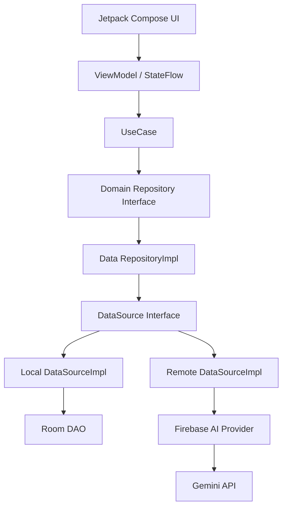

<div align="center">

# 🗣️ AAC TALK AI

### 단어 선택부터 자연스러운 문장 표현까지, AI 기반 보완대체의사소통(AAC) 앱

**그림·단어 선택 → AI 문장 추천 → 음성 출력(TTS) → 나만의 문장 저장**


</div>

---

## 📌 프로젝트 소개

**AAC TALK AI**는 구어 의사소통에 어려움을 겪는 사용자가 그림과 단어를 선택하고, 이를 자연스러운 문장으로 표현하도록 돕는 Android AAC(Augmentative and Alternative Communication, 보완대체의사소통) 애플리케이션입니다.

단순히 상징을 나열하는 데서 나아가, **카테고리별 단어 탐색**, **AI 기반 문장 추천**, **TTS 음성 출력**, **자주 쓰는 문장 저장**을 하나의 사용 흐름으로 연결하는 것을 목표로 합니다.

> **배경**: 2025 「장애 플러스 기술」 장애인 앱 개발 공모전의 개발제안서를 바탕으로 설계한 프로젝트입니다. 의사소통의 자립성과 단계적 언어 학습을 지원하는 데 중점을 뒀습니다.

## ✨ 주요 기능

| 기능 | 설명 | 현재 상태 |
| :--- | :--- | :---: |
| 🗂️ 카테고리 탐색 | 사람·장소·음식·활동·상태 등의 카테고리에서 그림과 단어 선택 | 구현 |
| 🧩 단계별 단어 선택 | 선택한 단어를 상단에 누적하고, 다음 카테고리로 이동하거나 건너뛰기 | 구현 |
| 🔊 음성 출력 | 선택한 단어나 저장한 문장을 TTS로 재생 | 구현 |
| 💾 나만의 문장 | 완성한 문장을 Room DB에 저장하고 다시 조회 | 구현 |
| ✨ AI 문장 추천 | 선택한 단어를 기반으로 Gemini에 자연스러운 문장 추천 요청 | 연동 코드 구현 · 동작 점검 중 |

## 📱 화면 구성


**사용 흐름**

```text
홈(카테고리 선택)
   ↓
단어 선택 및 누적 → 필요 없는 카테고리 건너뛰기
   ↓
선택한 단어 확인
   ├─ TTS 음성 출력
   └─ AI 문장 추천 요청 (현재 점검 중)
         ↓
     문장 선택 및 저장
         ↓
     나만의 문장 목록에서 재사용
```

## 🏗️ 아키텍처

**Clean Architecture + MVVM**을 기준으로 UI, 비즈니스 규칙, 데이터 접근 책임을 분리했습니다. Repository와 DataSource는 인터페이스에 의존하고, Hilt로 구현체를 연결합니다.

> Note: 아래 아키텍처 다이어그램의 화살표는 런타임에서의 호출 및 데이터 처리 흐름(Call Flow) 을 나타내며, 코드의 의존성 방향(Dependency Direction)을 의미하지 않습니다.
> Clean Architecture의 의존성 역전 원칙에 따라 Data Layer가 Domain Layer의 Repository 인터페이스에 의존하도록 설계했습니다


```text
app/src/main/java/edu/vt/mobiledev/aacapplication/
├── ui/                  # Compose 화면 · ViewModel
├── domain/
│   ├── model/           # 순수 도메인 모델
│   ├── repository/      # Repository 인터페이스
│   └── usecase/         # 기능별 유스케이스
├── data/
│   ├── datasource/      # DataSource 인터페이스
│   ├── impl/            # RepositoryImpl
│   ├── mapper/          # Domain ↔ Data 변환
│   └── model/           # DataModel
├── local/               # Room Entity / DAO / LocalDataSourceImpl
├── remote/              # FirebaseAiProvider / RemoteDataSourceImpl
└── di/                  # Hilt 모듈
```

> 현재는 **단일 Android `app` 모듈 안에서 패키지로 계층을 분리**한 구조입니다. 별도의 Gradle 멀티모듈로 분리한 상태는 아닙니다


## 🛠️ 기술 스택

| 영역 | 기술 |
| :--- | :--- |
| Language | Kotlin |
| UI | Jetpack Compose, Material 3 |
| Architecture | Clean Architecture(패키지 분리), MVVM |
| Asynchronous | Kotlin Coroutines, StateFlow |
| Dependency Injection | Hilt |
| Local Database | Room |
| AI | Firebase AI Logic, Gemini API |
| Speech | Android TextToSpeech (TTS) |

## 🚀 로컬 실행 - 현재 Firebase.ai 해당 버전 만료로 인해 사용 불가능합니다

1. 저장소를 클론하고 Android Studio에서 프로젝트를 엽니다.
2. 본인의 Firebase 프로젝트에 Android 앱 패키지 `edu.vt.mobiledev.aacapplication`을 등록합니다.
3. Firebase에서 내려받은 `google-services.json`을 `app/google-services.json` 위치에 넣습니다.
4. Gradle Sync 후 Android 기기 또는 에뮬레이터에서 앱을 실행합니다.


<div align="center">

**AAC TALK AI — 더 자연스럽게 표현하고, 더 쉽게 소통하도록**

</div>
